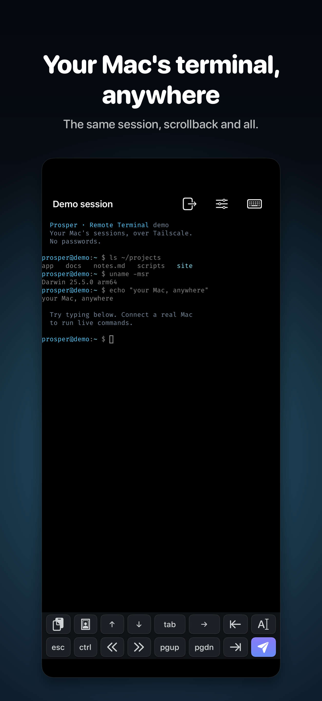
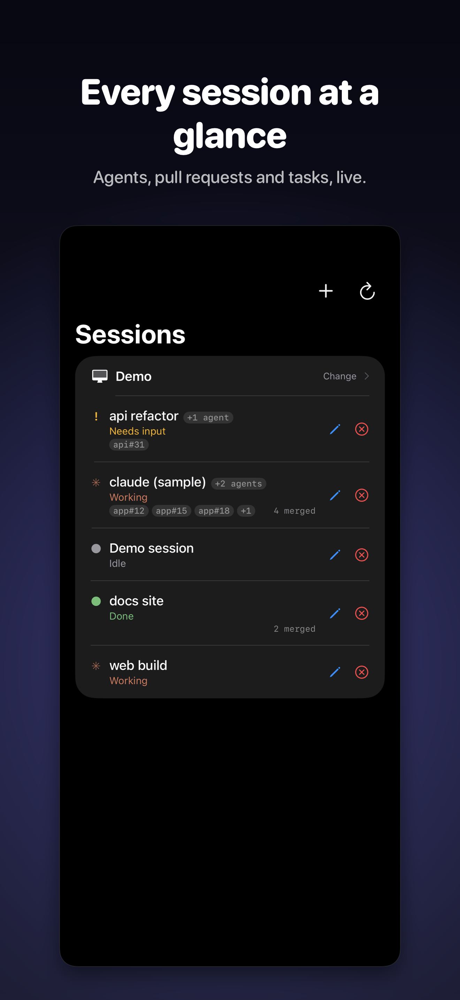
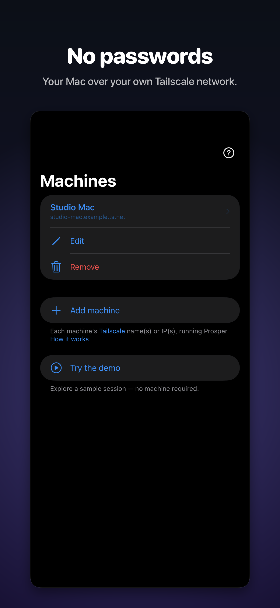
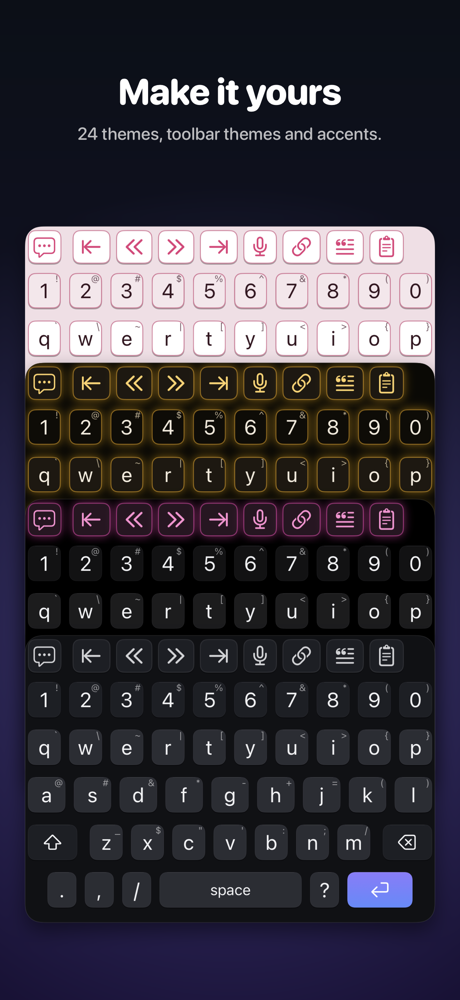
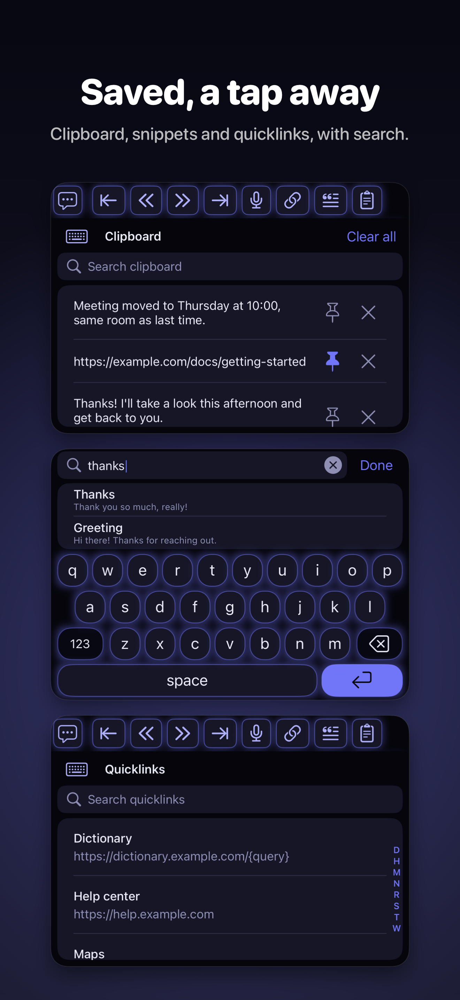
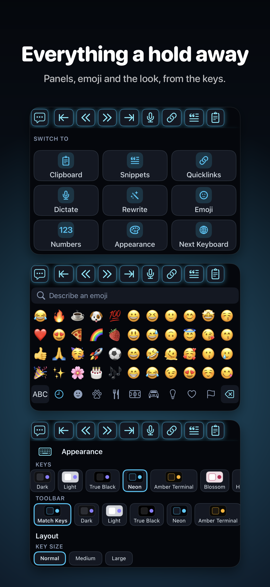
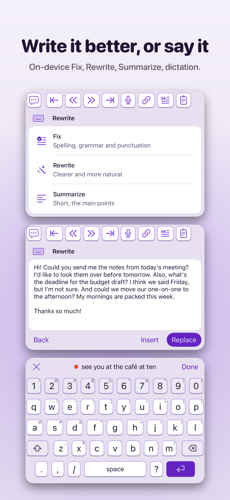
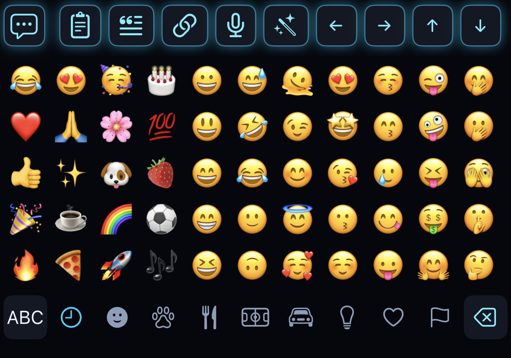
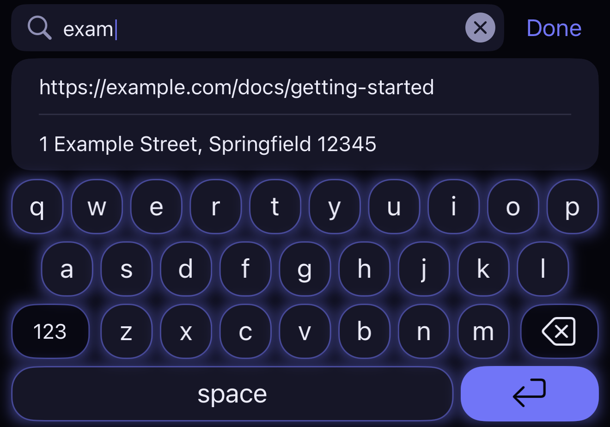
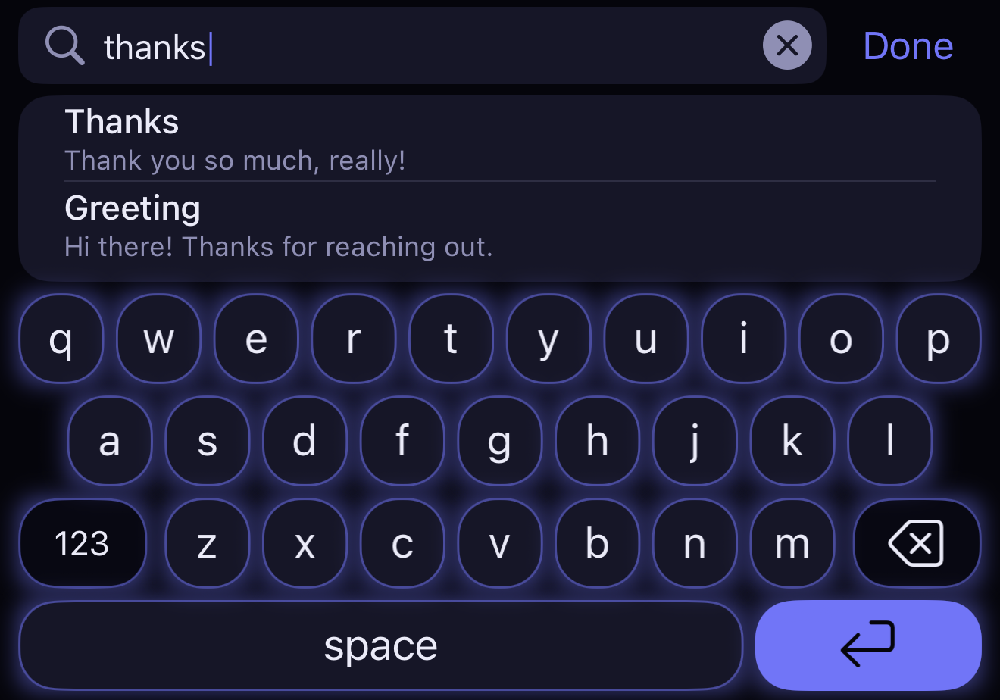

# Prosper (iOS)

Prosper for iOS / iPadOS / Mac Catalyst — on the App Store as **Prosper Remote**. A home for
Prosper's mobile features.

**Remote Terminal** attaches to long-running `dch` (a `dtach` fork) sessions hosted by
[Prosper](https://github.com/) on your Mac, reached over
[Tailscale](https://tailscale.com). No passwords: Tailscale is the trust boundary.

**The Prosper keyboard** is the terminal's keyboard as an iOS system keyboard for every app.

- Bundle id: `eu.illegible.prosperios`
- Min iOS: 16.0 · also builds for Mac Catalyst
- Terminal rendering: [SwiftTerm](https://github.com/migueldeicaza/SwiftTerm)

## Features (1.0)

- **The same session, not a new one**: full scrollback and live output, a silent reconnect
  after a drop, keystrokes typed meanwhile queued and delivered.
- **Terminal**: a compact keyboard and a two-row shortcut bar (sticky ctrl, word jumps,
  page up/down, send), rearranged in Settings; copy mode, tap-to-open links, double-tap word
  selection, Insert to compose before sending, a mic key.
- **Sessions**: create, rename, stop, or start an agent session; each row shows its agents,
  pull requests and tasks; restart or stop agents; a Sidekicks tab. From the ⋯ menu:
  **History** (resume ended sessions, pin), **Chat** with the Mac's local model, and the Mac's
  **Commands**.
- **The Prosper keyboard, in every app** (Settings › General › Keyboard › Keyboards):
  - a toolbar of edit keys (word and line jumps, line deletes, cut line, Paste) in one or two rows, behind a
    toggle whose hold opens a menu of panels, emoji, numbers, languages and Appearance;
  - themes, toolbar themes and accents; Normal, Medium or Large keys; a numbers row, or a 123
    key with a numpad;
  - English and Bulgarian, by a language key or a keyboard per language for the globe;
  - every emoji group, with search and skin tones;
  - clipboard history with search, synced both ways with the Mac's (the newest phone copy goes
    onto the Mac's ⌘V);
  - snippets and quicklinks with search, the phone's own plus the Mac's with Sync from Mac;
  - dictation, on device, in English (iOS 26);
  - Fix, Rewrite and Summarize by Apple's on-device model (iOS 26, Apple Intelligence).
- **Live status and alerts** (optional, signed in): a Live Activity per Mac while its agents
  work, and a push notification only when a session needs you, sent through Prosper's server
  over APNs. Only session names and states, never terminal content.
- **Remote Wake** (optional, signed in): wake a sleeping Mac from the phone.
- **Share › Prosper** from any app to a session's prompt; Shortcuts, Control Center controls and
  a Sessions widget.
- A built-in **demo** session to explore without a Mac.

## Requirements

- iPhone or iPad on iOS 16 or later; dictation and Fix/Rewrite/Summarize need iOS 26, the
  latter on an Apple Intelligence device.
- For Remote Terminal: [Prosper](https://github.com/) on your Mac with
  Remote Terminal on, and Tailscale on the Mac and the phone in the same tailnet. The keyboard
  works without a Mac; clipboard and library sync need one.
- An account (passwordless email link) only for Remote Wake and Live status.

## Screenshots

| Terminal | Sessions | Machines |
|----------|----------|----------|
|  |  |  |
| **Themes** | **Clipboard, snippets, quicklinks** | **Hold menu** |
|  |  |  |
| **Rewrite and dictation** | | |
|  | | |

Add a machine by its Tailscale name/IP, pick a running `dch` session, and the
exact same terminal — scrollback and all — picks up on your phone. A built-in
demo session lets you explore without a Mac.

## Keyboards

The terminal's own keyboard, and Prosper as a system keyboard in every app: a toolbar of
edit keys, the clipboard history, snippets and quicklinks (each searchable), every emoji
group, dictation and on-device rewriting, in any of its themes.

| Terminal (Neon) | Dark | Blossom |
|-----------------|------|---------|
|  |  |  |
| **Amber Terminal** | **True Black keys, Rose toolbar** | **Bulgarian (Teal)** |
|  |  |  |
| **Hold menu** | **Appearance** | **Numbers: 123 key** |
|  |  |  |
| **Numpad** | **Clipboard history** | **Snippets, A–Z** |
|  |  |  |
| **Quicklinks** | **Fix, Rewrite, Summarize** | **Dictation** |
|  |  |  |
| **Emoji, every group** | **Search the clipboard** | **Search snippets** |
|  |  |  |
| **Key size: Normal** | **Medium** | **Large** |
|  |  |  |

`scripts/keyboard-shots.sh <sim-udid> <derived-data>` (an iPhone Pro Max simulator) draws these
from the real keyboard views with made-up data, and the App Store's iPhone slides with them: the
app's own screens on the offline demo, then the keyboard's.

## Build & run locally

The Xcode project is generated from `app/project.yml` by
[XcodeGen](https://github.com/yonaskolb/XcodeGen) (`brew install xcodegen`).

```sh
./run.sh           # build + launch Mac Catalyst app
./run.sh ios       # iOS Simulator
./run.sh device    # sign + install on a connected iPhone (needs a team)
./run.sh build     # Catalyst build only
```

## CI/CD → TestFlight

Pushing to `main` builds and uploads to TestFlight via
`.github/workflows/testflight.yml`. Signing is fully automatic through an
App Store Connect API key — no certificates or profiles live in the repo.

It needs four repo secrets: `ASC_KEY_ID`, `ASC_ISSUER_ID`, `ASC_KEY_P8` and
`APPLE_TEAM_ID`.

## License

MIT — see [`LICENSE`](LICENSE). SwiftTerm is MIT-licensed.

The emoji list and the emoji search's names and keywords are Unicode's
(emoji-test.txt and [CLDR](https://github.com/unicode-org/cldr) annotations), © Unicode, Inc.,
under the [Unicode License v3](https://www.unicode.org/license.txt), its notice in
[`EmojiData.swift`](app/Sources/Keys/EmojiData.swift).
